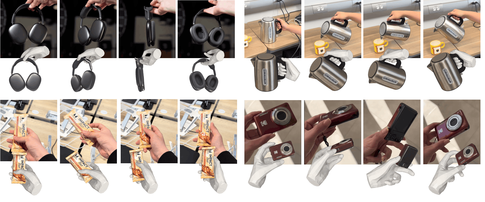

# 4D-HOF: Hand-Object Flow Matching for Feed-Forward 4D Interaction Reconstruction

<a href='https://tamu-visual-ai.github.io/4D-HOF/'></a>
<a href='https://arxiv.org/abs/2610.08782'></a>
<a href='https://huggingface.co/eggplant71/4D-HOF'></a>

This is the official implementation of 4D-HOF: Hand-Object Flow Matching for Feed-Forward 4D Interaction Reconstruction.

<p align="center">
  
</p>

The current release includes inference code for HO3D. Stay tuned for more!

## Environment setup

You need an NVIDIA GPU with a compatible driver, Conda, Git, a C++ compiler, and internet access.

Run these commands to install the dependencies and activate the environment:

```bash
bash setup_env.sh
conda activate 4dhof
```

Download the MANO models from the [official MANO website](https://mano.is.tue.mpg.de/) (sign up and accept the license). Extract the download and place `MANO_RIGHT.pkl` at `_DATA/mano/MANO_RIGHT.pkl` in this repository.

## HO3D Experiments

From the repository root, download the checkpoint and HO3D initialization:

```bash
bash download_assets.sh
```

Files are saved in this layout:

```text
checkpoints/4dhof.pth
_DATA/ho3dv3_init/<sequence>/
    hand.pkl
    mesh.pkl
    pose.pkl
    mask.pkl
    contact.pkl
    intrinsics.pkl
```

Download [HO3D_v3](https://onedrive.live.com/?id=%2Fpersonal%2F11742dd40d1cbdc1%2FDocuments%2FHO3D%5Fv3&listurl=%2Fpersonal%2F11742dd40d1cbdc1%2FDocuments&ithint=folder&e=BevrKO&migratedtospo=true&redeem=aHR0cHM6Ly8xZHJ2Lm1zL2YvcyFBc0c5SEEzVUxYUVJsRnk1dENaWGFoQWUzYkVWP2U9QmV2cktP&ga=1) and set `--ho3d-root` to its directory containing `train/`, `train.txt`, and `models/`.

Run inference on HO3D sequences from the repository root:

```bash
python infer_ho3d.py --ho3d-root /path/to/HO3D_v3
```

Results are saved to `results/ho3d`.

Evaluate all sequences:

```bash
python eval_ho3d.py --ho3d-root /path/to/HO3D_v3
```

Results are saved to `eval_ho3d.json` in the prediction directory.


## Cite
If you find our work useful, please consider citing:
```
@article{li2026_4dhof,
  title   = {4D-HOF: Hand-Object Flow Matching for Feed-Forward 4D Interaction Reconstruction},
  author  = {Li, Shiqi and Cho, Sean and Li, Yijie and Guo, Fengzhi and Wen, Bowen and Zhang, Cheng},
  journal = {arXiv preprint arXiv:2610.08782},
  year    = {2026}
}
```

## Acknowledgments

We thank the authors of [HOLD](https://github.com/zc-alexfan/hold), [MagicHOI](https://github.com/byran-wang/MagicHOI), [AGILE](https://github.com/aim-uofa/AGILE), [CHOIR](https://github.com/hxwork/CHOIR), [SAM](https://github.com/facebookresearch/sam3), [MoGe](https://github.com/microsoft/MoGe), [Hunyuan3D](https://github.com/Tencent-Hunyuan/Hunyuan3D-2), [MV-Adapter](https://github.com/huanngzh/MV-Adapter), [FoundationPose](https://github.com/NVlabs/FoundationPose), [WiLoR](https://github.com/rolpotamias/WiLoR), [HACO](https://github.com/dqj5182/HACO_RELEASE), [DINO](https://github.com/facebookresearch/dinov2), and [Point Transformer V3](https://github.com/Pointcept/PointTransformerV3) for sharing their work and code.
